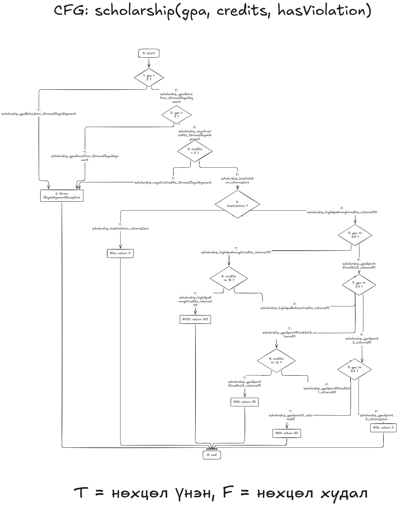

# Лаб 9: Код хамралт, JaCoCo

**Оюутан:** Г. Лувсанжал, **код:** B242270016
**GitHub:** jal0115

## Орчин

    java version "23.0.1" 2024-10-15
    Java(TM) SE Runtime Environment (build 23.0.1+11-39)
    Java HotSpot(TM) 64-Bit Server VM (build 23.0.1+11-39, mixed mode, sharing)
    Apache Maven 3.9.9
    Maven home: /usr/share/maven
    Java version: 23.0.1, vendor: Oracle Corporation, runtime: /usr/lib/jvm/jdk-23
    Default locale: en, platform encoding: UTF-8
    OS name: "linux", version: "6.12.107+deb13-amd64", arch: "amd64", family: "unix"

## A: Happy path ба эхний хэмжилт

Хэвийн урсгалын 5 тест бичсэн (`letterGrade` 2, `gpa` 1, `scholarship` 2): `results/mvn-verify-A.txt` дахь `Tests run: 5, Failures: 0`.

`results/jacoco-A.csv`-ээс: **Branch 22/41 хамрагдсан** (19 дутуу, ≈ 53.7%), **Line 16/25 хамрагдсан** (9 дутуу, 64%). JaCoCo-ийн HTML тайлан Branch-ийг `53%` гэж таслан харуулдаг.

Тайлан дээрх ажиглалт: улаан (огт хүрээгүй) мөрүүд нь бүх `throw new IllegalArgumentException` алдааны замууд, мөн `D`/`F` үсгэн дүн буцаах мөрүүд, `scholarship()`-ийн сахилгын зөрчилтэй (`hasViolation`) зам ба 50, 0 тэтгэлэг буцаах мөрүүд. Шар ромботой мөрүүд нь `if (... || ...)` ба `&&` нөхцөлтэй мөрүүд: happy path тестүүд нөхцөл бүрийн зөвхөн нэг талд (үнэн биш талд) хүрсэн тул ердөө хагас хамрагдсан.

## AI ашигласан тухай

Энэ лабт AI туслахыг (Claude) алхам бүрийг тайлбарлуулах, тестийн ноорог болон README-ийн ноорог бичүүлэхэд ашигласан. Бүх тестийг өөрөө ажиллуулж, JaCoCo тайланг өөрөө нээж шалгасан, results/ файлууд бодит `mvn verify` гаралт болно.

## B: CFG ба 100% хамралт

`scholarship()`-ийн CFG: `cfg.png`. `||`, `&&`-ийн нөхцөл бүрийг тусдаа шийдвэрийн зангилаа болгож, ирмэг бүр дээр түүнийг дайрдаг тестийн нэрийг бичсэн (нэрс нь `ScholarshipCalculatorTest.java` дахь метод нэртэй таарна). CFG-ийн ноорогийг AI-аар Mermaid кодоор гаргуулж Excalidraw-д оруулсан, дараа нь өөрөө байрлалыг засаж, гарчиг, T/F тайлбар нэмсэн.

Branch ба Line хамралтыг 100% хүргэхэд нийт **21 тест** шаардагдсан (A-ийн 5 + B-д нэмсэн 16): `results/mvn-verify-B.txt` дахь `Tests run: 21, Failures: 0`. `results/jacoco-B.csv`-д **BRANCH_MISSED = 0**, **LINE_MISSED = 0** (Branch 41/41, Line 25/25).

## C: Давталтын заагийн тестүүд

`gpa()`-ийн давталтад 0 / 1 / 2+ дүрмийг хэрэгжүүлсэн: 0 удаа → `gpa_emptyArray_throwsIllegalArgument`, `gpa_nullArray_throwsIllegalArgument` (assertThrows); 1 удаа → `gpa_singleScore_returnsFour`; 2+ удаа → `gpa_multipleScores_returnsTwoPointFive`.

Эдгээр тест хамралтыг өсгөөгүй (Branch, Line аль хэдийн 100%) боловч хэрэгтэй хэвээр: хамралт нь мөр, салаа "хүрсэн эсэх"-ийг л хэмждэг, давталтын тоо буруу байх алдааг (жишээ нь индексийг 1-ээс эхлүүлэх, сүүлийн элементийг алгасах, `length`-ийг буруу хуваах) илрүүлдэггүй. Нэг дүнтэй (`[95]`), олон дүнтэй (`[95,85,75,65]`) тест нь голчийн тооцоо тус бүрд зөв ажиллаж байгааг баталгаажуулдаг.
